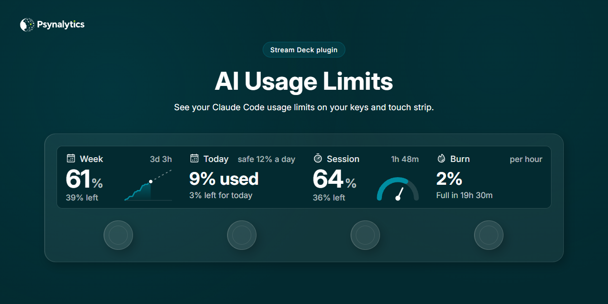
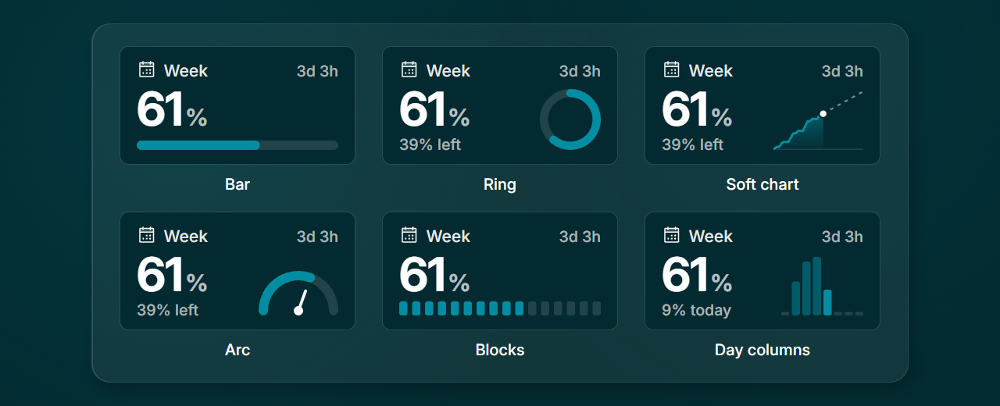

# AI Usage Limits

[](LICENSE)
[](#requirements)



AI Usage Limits is a Stream Deck plugin that shows your Claude Code usage limits on keys and on the Stream Deck+ dials and touch strip.

## What it shows

Each key or dial shows one view. Turn a dial to move to the next one.

| View | What you see |
|---|---|
| Week | How much of your weekly limit you have used and the time until it resets |
| Model | The weekly limit for one model. The label is the model name the service reports. If there are several, it shows the one closest to full |
| Burn | How fast your weekly use rose over the last hour and when the week would be full at that pace |
| Runs out | The day and time your weekly limit runs out at your average pace so far this week. If it lasts the week, the level you will end near |
| Today | How much of the weekly limit you used today and what is left of your even daily share |
| Session | How much of the five-hour session limit you have used and the time until it resets |

The chart turns amber at 75 percent and red at 90 percent. You can move both points in the settings panel.

## Chart styles

On the touch strip the Week, Model and Session views can draw their figure in six styles. On a key those three views always show a bar. The other views show words on keys and on the touch strip.



- **Bar.** The figure with a bar beneath it.
- **Ring.** The figure beside a ring that fills as you use the limit. The share you have left sits under the figure.
- **Soft chart.** The week so far as a filled line. A dashed line runs on to the level forecast for the reset.
- **Arc.** A half-circle gauge with a needle. The share you have left sits under the figure.
- **Blocks.** Sixteen blocks that light up as you use the limit.
- **Day columns.** One column for each day of the weekly window. Each column shows that day's rise. Today's column is in full colour.

The soft chart and day columns draw on an hourly history the plugin keeps while it runs. The Session view keeps no history and shows a bar instead.

## Install

There is no packaged installer yet. You install the plugin from source.

1. Install [Git](https://git-scm.com/) and [Node.js](https://nodejs.org/) with npm. Without Git, you can download this repository as a ZIP file from GitHub and unzip it.
2. Clone this repository and install the plugin's one dependency.

   ```powershell
   git clone https://github.com/llewellynvz/stream-deck-ai-usage-limits.git
   cd stream-deck-ai-usage-limits\com.psynalytics.claude-usage.sdPlugin
   npm install
   ```

   If you downloaded the ZIP file, skip the first two lines. Open a terminal in the unzipped folder that holds this README. Then run `cd com.psynalytics.claude-usage.sdPlugin` and `npm install`.

   If PowerShell says running scripts is disabled, run the same commands in Command Prompt. Leave out `git clone` if you already ran it.

3. Copy the `com.psynalytics.claude-usage.sdPlugin` folder into `%APPDATA%\Elgato\StreamDeck\Plugins`.
4. Restart Stream Deck.
5. Find **Usage** under **Psynalytics** in the action list and drag it onto a key or a dial.

## Use

- Turn a dial to change the view. The dial keeps the view you chose.
- Press a dial or tap its part of the touch strip to refresh now.
- Touch and hold the touch strip to open your usage page on claude.ai.
- Press a key to refresh now. Hold the key for at least 0.6 seconds to open the usage page.
- A refresh within 30 seconds of the last request does not ask the service again.

Select a key or dial in Stream Deck to open its settings panel.

| Setting | What it does |
|---|---|
| View | Picks the view to show |
| Chart | Picks the chart style for the touch strip |
| Background, Bar, Text | Set the three colours of the face |
| Reset colours to default | Puts the three colours back to their defaults |
| Amber at, Red at | Set the percentages at which the chart turns amber and red |
| Auto-rotate | Moves on to the next view that has data after a set number of seconds |
| Seconds | Sets how many seconds each view stays up during auto-rotate. The range is 3 to 120 |

## Privacy and security

- The plugin reads your Claude Code sign-in from `~/.claude/.credentials.json`. If you set `CLAUDE_CONFIG_DIR`, it reads `.credentials.json` in that folder instead.
- It takes only the access token and its expiry time from that file.
- It sends the token only to the usage address `https://api.anthropic.com/api/oauth/usage`.
- A redirect from that address ends the request. The token never goes on to a second host.
- It never writes, refreshes or renews your sign-in. When the token expires, the dial shows **Sign in**. Open Claude Code once and the plugin picks up the new token within about a minute.
- There is no telemetry. Apart from the usage address, the plugin code contacts no other host. A long press opens your usage page in your browser. The Stream Deck SDK and the settings panel talk only to the Stream Deck app on your own computer.
- The Stream Deck app stores your settings for each key and dial. It also stores a small usage history with one point per hour. Each point holds the time and your weekly and model percentages. The plugin keeps the last three weekly windows of at most 200 points each.
- The plugin never stores the token.
- It writes state changes, limit types and error codes to the Stream Deck log. No log line holds the token.

## Requirements

- Windows 10 or later. Tested on Windows 11.
- Stream Deck 7.1 or later. Tested on Stream Deck 7.6.
- A Stream Deck with keys. The dials and touch strip need a Stream Deck+.
- Claude Code signed in on the same computer.
- Node.js with npm to install from source. Stream Deck runs the plugin on its own bundled Node.js 20.

## Good to know

- This is an unofficial plugin. It is not affiliated with or endorsed by Anthropic or Elgato.
- It reads an undocumented usage address. That address can change or stop working without notice.
- Anthropic's [legal page for Claude Code](https://code.claude.com/docs/en/legal-and-compliance) says the Claude Code sign-in is meant for Claude Code and Anthropic's own apps. This plugin uses that sign-in to read your usage figures. You use the plugin at your own risk.
- The plugin asks for new figures every five minutes while a key or dial shows it. It stops asking when none is on screen.
- If a request fails, the dials keep the last figures while they are under 30 minutes old. After that they show **Offline**.
- Sometimes the service turns a request away because it has had too many. The plugin then waits for the time the service asks for. The wait is never less than five minutes and never more than 30.
- If the service rejects your sign-in, the dials show **Sign in**. The plugin does not try that token again for 30 minutes.
- It runs on Windows only for now.
- I have tested it only on Windows 11 with a Stream Deck+. Windows 10 and other Stream Deck models are untested.

## Development

The tests use the Node.js test runner. Install the plugin's dependency first.

```powershell
cd com.psynalytics.claude-usage.sdPlugin
npm install
cd ..
npm test
```

If PowerShell says running scripts is disabled, run the same commands in Command Prompt.

The suite passes on Node.js 20.20.2 and on Node.js 26.13.1. The first is the version bundled with the Stream Deck app.

One test is skipped by default. It reads your real sign-in and calls the live usage service. Set the environment variable `LIVE_SIGNIN` to `1` to run it.

## Licence

The code is released under the [MIT licence](LICENSE). Copyright 2026 Llewellyn van Zyl. The Psynalytics name and logo are not covered by the MIT licence.

Third-party works and their licences are listed in [THIRD-PARTY-NOTICES.md](THIRD-PARTY-NOTICES.md).

## Credits

- Icons from [Phosphor Icons](https://github.com/phosphor-icons/core).
- The settings panel uses [sdpi-components](https://github.com/GeekyEggo/sdpi-components). That library bundles [Lit](https://github.com/lit/lit).
- The plugin runs on the [Stream Deck SDK](https://github.com/elgatosf/streamdeck) by Elgato.
- Made by Llewellyn van Zyl.
